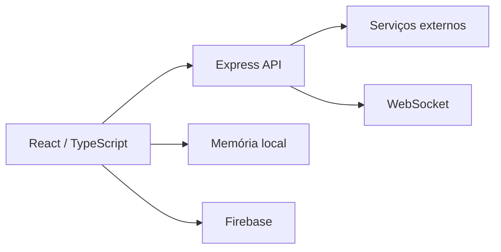

# Arquitetura técnica

## Componentes

- [Interface](../src/App.tsx) e [componentes](../src/components): experiências de conversação, workspace e integrações.
- [Servidor](../server.ts): endpoints HTTP e comunicação WebSocket.
- [Entrada da API](../api/index.ts): integração com o servidor.
- [Memória local](../src/lib/indexedDbMemory.ts) e [hook de memória](../src/hooks/useUserMemory.ts).
- [Firebase](../src/firebase.ts): configuração de integração.

## Grupos de API

O servidor contém rotas para conversação, áudio, sincronização de memória, pesquisa e integrações. Consulte a implementação para os formatos de entrada e saída.

## Antes de uma implantação pública

Validar autenticação e autorização em cada rota, proteção de credenciais, limites de requisição, tratamento de dados pessoais e regras Firebase. Não confundir presença de código com garantia de disponibilidade ou segurança.

Execute `npm run lint` e `npm run build` no ambiente configurado.
